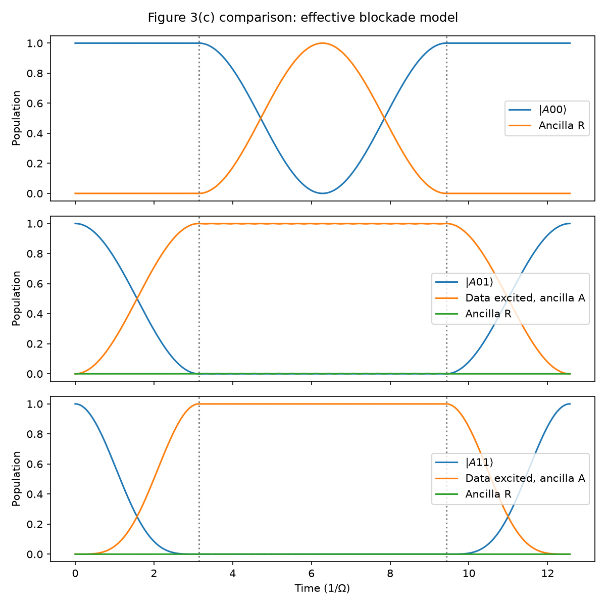
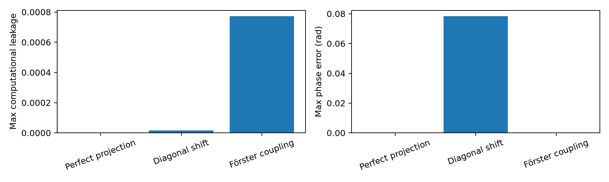
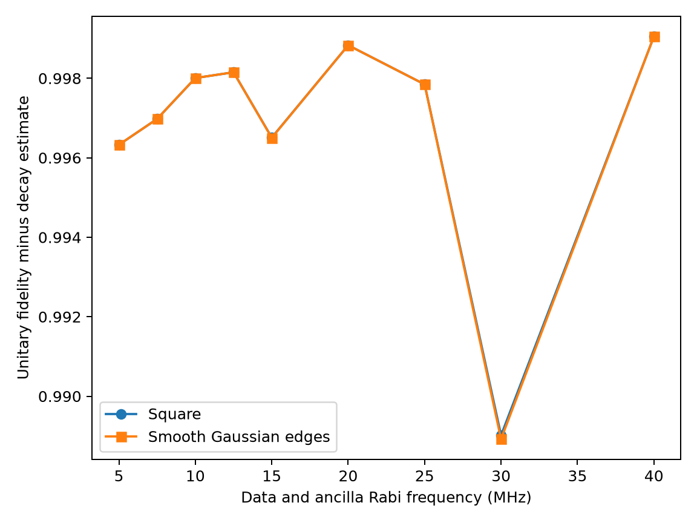
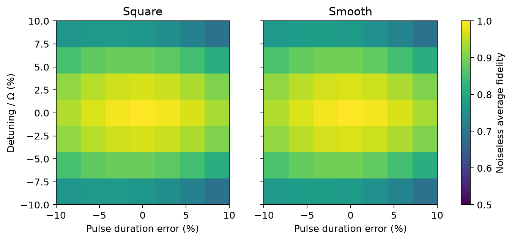

[Zhang, Arunseangroj, and Xu (2025)](https://arxiv.org/abs/2503.16896) propose an ensemble-assisted CZ gate. This repository simulates its data $\pi$ pulse, ancilla $2\pi$ pulse, data $\pi$ pulse sequence. The data drive is $|1\rangle\leftrightarrow|r\rangle$; the ancilla drive is $|A\rangle\leftrightarrow|R\rangle$. The [Fig. 3(c)](https://arxiv.org/html/2503.16896v1) parameters give a $0.20\,\mu\mathrm{s}$ gate: $\Omega_r=\Omega_R=2\pi\times10$ MHz and $V_{Rr}=2\pi\times200$ MHz.

In the diagonal-blockade model, peak ancilla $|R\rangle$ population is 1.000000 for $|A00\rangle$, 0.002494 for $|A01\rangle$, and 0.000625 for $|A11\rangle$. The corresponding return probabilities are 1.000000, 0.999985, and 0.999999. The pulse timing and blockade pattern agree qualitatively with Fig. 3(c). 

The paper's [Eq. (4)](https://arxiv.org/html/2503.16896v1) gives $U=\text{diag}(-1,-1,-1,+1)=-CZ$. The diagonal model instead gives $\text{diag}(-1,-0.9969-0.0783i,-0.9969-0.0783i,0.9992+0.0392i)$. Leakage is only $1.54\times10^{-5}$, but the largest phase error is 0.078393 rad. A truncated resonant Förster model based on Supplementary Eq. (29) removes that phase error to numerical precision and has leakage 0.000773.

The [paper's Table II](https://arxiv.org/html/2503.16896v1) gives 99.80% CZ fidelity, with 0.15% data decay, 0.03% ancilla decay, and 0.02% blockade error. The simulated noisy *diagonal* model gives 99.7351% average fidelity. Its isolated data and ancilla errors are 0.1498% and 0.0299%; its blockade error is 0.0852%. The *noiseless Förster* model gives 0.0194% blockade infidelity. These are different models. A combined noisy Förster fidelity has not been calculated, so 99.80% is not reproduced.

The smooth data pulse has the same duration and area as the square pulse. At 10 MHz, noiseless Förster fidelity is 0.9998063 for square and 0.9998066 for smooth. The drive sweep subtracts a first-order decay estimate; it is not the full noisy calculation in [Supplementary Fig. 4(a)](https://arxiv.org/html/2503.16896v1). Under this pulse constraint, smoothing gives no consistent improvement.

The additional detuning and timing scan reaches 0.685775 square-pulse fidelity at its worst sampled point over $\pm0.1\Omega$ detuning and $\pm10\%$ duration error. Smooth pulses behave similarly. The numerical results and remaining model limits are described in [report.md](report.md).

