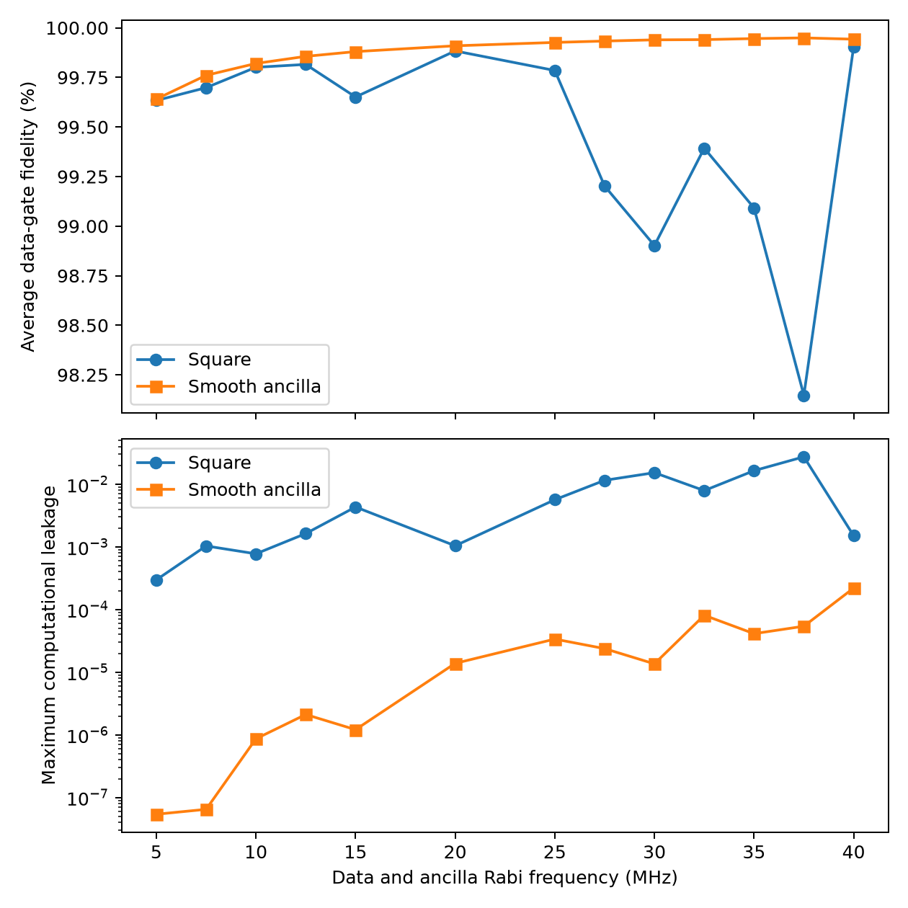

# Ensemble-assisted CZ gate: numerical reproduction

This project simulates the CZ protocol in [Zhang, Arunseangroj, and Xu (2025)](https://arxiv.org/html/2503.16896v1). The sequence is a data $\pi$ pulse, an ancilla $2\pi$ pulse, and a second data $\pi$ pulse. The baseline uses $\Omega_r=\Omega_R=2\pi\times10$ MHz and resonant Förster coupling $V_{Rr}=2\pi\times200$ MHz.

The corrected resonant Förster calculation gives **99.8008%** average data-gate fidelity at 10 MHz with the paper's Rydberg lifetimes (100 µs for data and 200 µs for ancilla). This agrees with the **99.80%** rounded value in Table II. The previous 99.7351% result used a diagonal-shift interaction, which produces a conditional phase for a resonant Förster pair. The previous drive plot also subtracted a decay estimate from a noiseless result; it was not a noisy gate simulation.

The 30 MHz dip persists with tighter solver tolerances. The square pulse gives 98.9020% noisy fidelity and 1.53% maximum noiseless computational leakage. Smoothing the **ancilla** $2\pi$ pulse with equal duration and area gives 99.9392% noisy fidelity and $1.4\times10^{-5}$ maximum noiseless leakage. The old comparison smoothed only data pulses, while the ancilla was in $|A\rangle$ and the Förster interaction was largely inactive; that is why those curves nearly coincided.

The paper specifies a smooth Gaussian rise and fall but does not give a unique envelope width or pulse normalization for Supplementary Fig. 4(a). Our shape is stated in [reproduce.py](reproduce.py); the numerical curve is a reproduction of the **reported mechanism and trend**, not a point-by-point digitization of that figure. See [report.md](report.md) for methods, results, and limits.

Run `./regenerate.sh` to regenerate figures and CSV files and run tests. The corrected sweep is in [results/drive_sweep.csv](results/drive_sweep.csv), and the baseline channels are in [results/reproduction_summary.csv](results/reproduction_summary.csv). The old [drive_sweep_estimate.png](figures/drive_sweep_estimate.png) remains as a record of the earlier approximation and should not be used as a noisy fidelity result.
