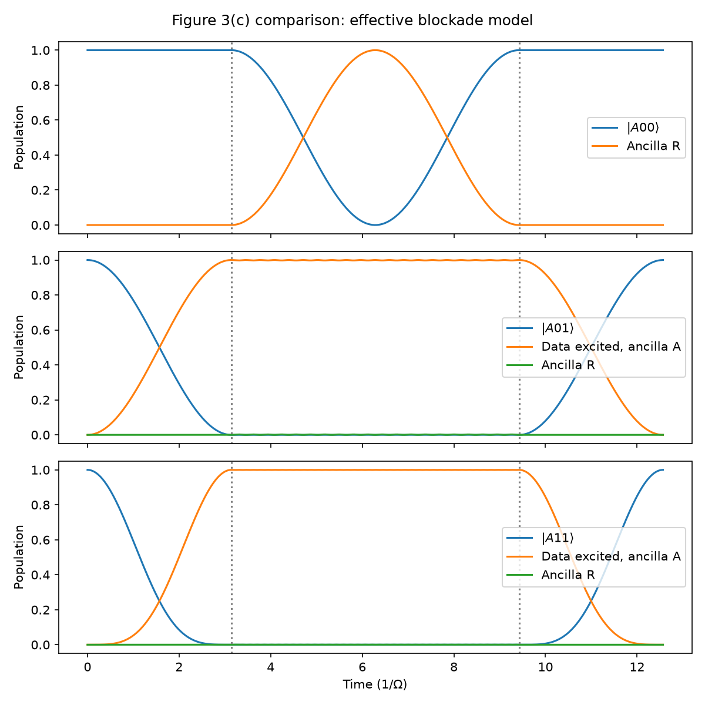
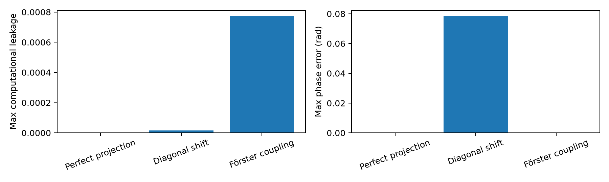
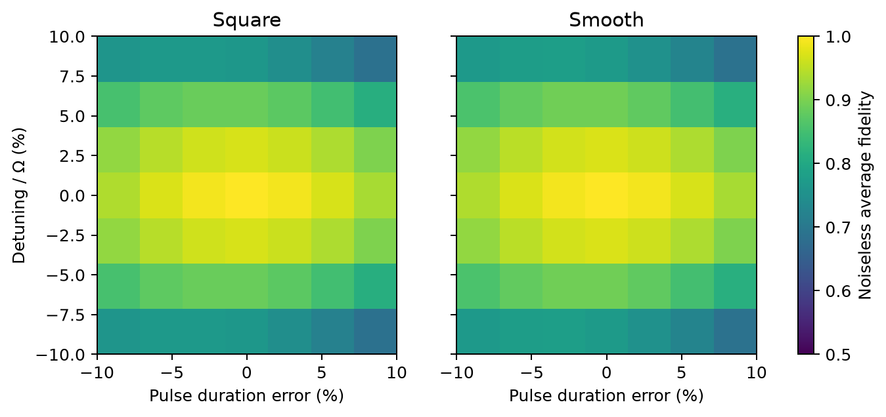

[Zhang, Arunseangroj, and Xu (2025)](https://arxiv.org/abs/2503.16896) propose an ensemble-assisted CZ gate. This repository simulates their three-pulse sequence: a data $\pi$ pulse, an ancilla $2\pi$ pulse, and a second data $\pi$ pulse. The data drive couples $|1\rangle\leftrightarrow|r\rangle$, while the ancilla drive couples $|A\rangle\leftrightarrow|R\rangle$. Using the parameters from [Fig. 3(c)](https://arxiv.org/html/2503.16896v1), the gate takes $0.20\,\mu\mathrm{s}$, with $\Omega_r=\Omega_R=2\pi\times10$ MHz and $V_{Rr}=2\pi\times200$ MHz.

In the diagonal-blockade model, the peak ancilla $|R\rangle$ population is 1.000000 for $|A00\rangle$, 0.002494 for $|A01\rangle$, and 0.000625 for $|A11\rangle$. The corresponding return probabilities are 1.000000, 0.999985, and 0.999999. The pulse timing and blockade behavior are qualitatively consistent with Fig. 3(c).

The paper's [Eq. (4)](https://arxiv.org/html/2503.16896v1) gives the ideal gate $U=\mathrm{diag}(-1,-1,-1,+1)=-CZ$. Our diagonal-blockade model instead gives $\mathrm{diag}(-1,-0.9969-0.0783i,-0.9969-0.0783i,0.9992+0.0392i)$. Leakage is small, at $1.54\times10^{-5}$, but the largest phase error reaches 0.078393 rad. A truncated resonant Förster model based on Supplementary Eq. (29) removes this phase error to numerical precision, with leakage of 0.000773.

The [paper's Table II](https://arxiv.org/html/2503.16896v1) reports 99.80% CZ fidelity, with contributions of 0.15% from data decay, 0.03% from ancilla decay, and 0.02% from blockade error.

Our noisy diagonal-blockade model gives 99.7351% average fidelity. Its isolated data and ancilla decay errors are 0.1498% and 0.0299%, close to the reported values, while its blockade error is higher at 0.0852%. The noiseless Förster model reduces blockade infidelity to 0.0194%. Because these results come from different models, they cannot be combined directly. A fully noisy Förster calculation has not been performed, so the paper's 99.80% fidelity has not yet been reproduced.

We also compare square and smooth data pulses with the same duration and pulse area. At 10 MHz, the noiseless Förster fidelity is 0.9998063 for the square pulse and 0.9998066 for the smooth pulse. The drive sweep uses a first-order decay correction rather than the full noisy calculation in [Supplementary Fig. 4(a)](https://arxiv.org/html/2503.16896v1). Under these pulse constraints, smoothing offers no consistent improvement.

Finally, we test sensitivity to detuning and pulse timing. Across a scan of $\pm0.1\Omega$ detuning and $\pm10\%$ duration error, the square-pulse fidelity falls as low as 0.685775. Smooth pulses show similar sensitivity. The numerical comparisons, assumptions, and remaining limitations are discussed in [report.md](report.md).

