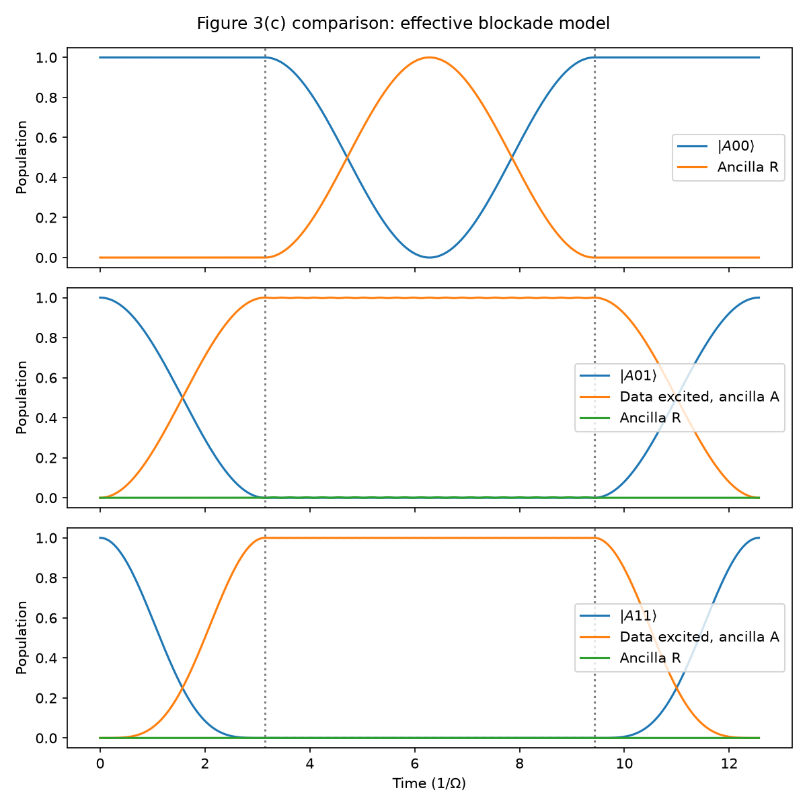
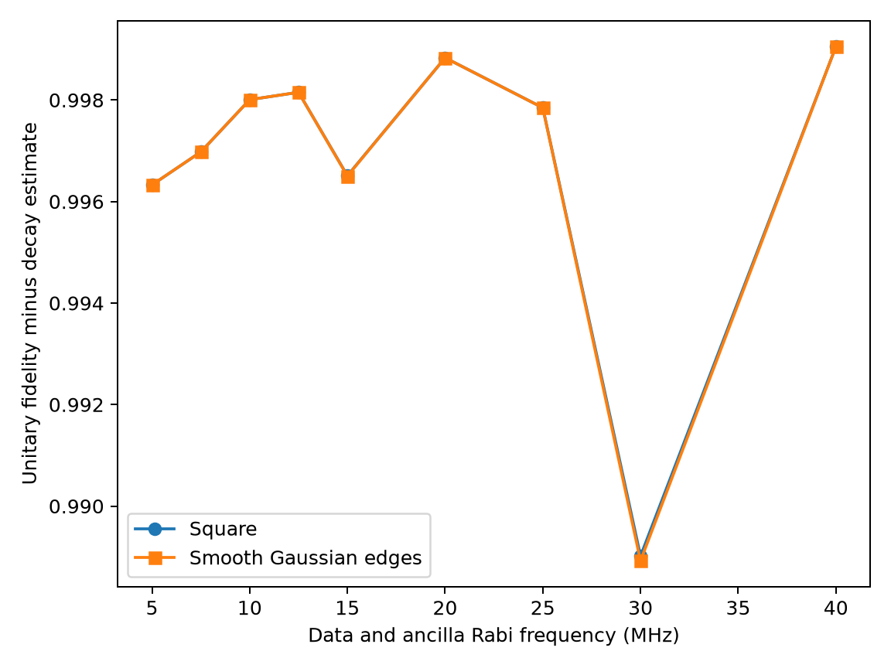
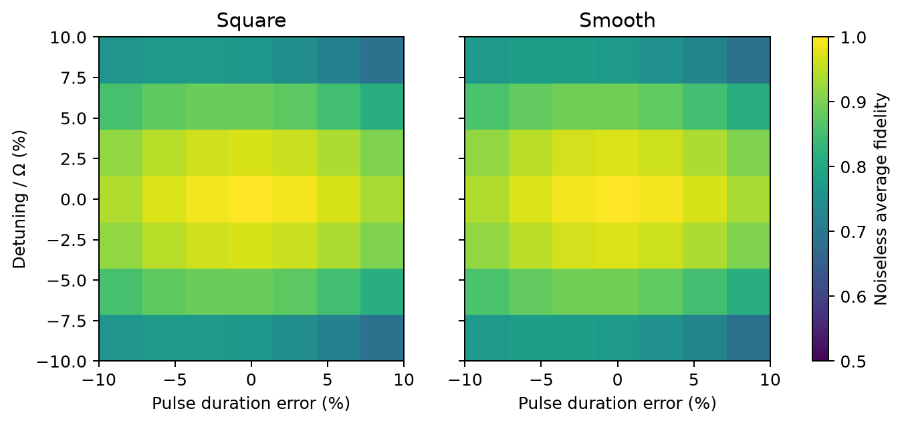

The gate in [Zhang, Arunseangroj, and Xu (2025)](https://arxiv.org/abs/2503.16896) uses two data atoms and an ensemble ancilla. A $\pi$ pulse excites data $|1\rangle$ to $|r\rangle$, an ancilla $2\pi$ pulse drives $|A\rangle\leftrightarrow|R\rangle$, and a final data $\pi$ pulse reverses the first. Rydberg interaction blocks the ancilla cycle when a data atom is excited. The [Fig. 3(c)](https://arxiv.org/html/2503.16896v1) parameters are $\Omega_r=\Omega_R=2\pi\times10$ MHz, $V_{Rr}=2\pi\times200$ MHz, and lifetimes of $100\,\mu\mathrm{s}$ for data $|r\rangle$ and $200\,\mu\mathrm{s}$ for ancilla $|A\rangle$ and $|R\rangle$.

The first model uses a diagonal shift $V_{Rr}|Rr\rangle\langle Rr|$ for each data atom. The $0.20\,\mu\mathrm{s}$ simulation gives peak ancilla $|R\rangle$ populations of 1.000000, 0.002494, and 0.000625 for $|A00\rangle$, $|A01\rangle$, and $|A11\rangle$. Final return probabilities are 1.000000, 0.999985, and 0.999999. These traces show the same gate mechanism as Fig. 3(c). Its plotted data were not digitized, so the comparison is qualitative.

The target in [Eq. (4)](https://arxiv.org/html/2503.16896v1) is $\text{diag}(-1,-1,-1,+1)=-CZ$. The diagonal model gives $\text{diag}(-1,-0.9969-0.0783i,-0.9969-0.0783i,0.9992+0.0392i)$. Its largest phase error is 0.078393 rad despite leakage of only $1.54\times10^{-5}$. This is why population return alone overstates gate quality.

The alternative model implements resonant $|rR\rangle\leftrightarrow|r'R'\rangle$ coupling from [Supplementary Eq. (29)](https://arxiv.org/html/2503.16896v1). It leaves out other pair states. The predicted dark state is proportional to $2V_{Rr}|1R\rangle-\Omega_r|r'R'\rangle$; its numerical energy differs from zero by less than $3.87\times10^{-12}\,\mathrm{rad}/\mu\mathrm{s}$. In the full gate, this truncated model gives 0.000773 maximum leakage and no measurable relative phase error. Its noiseless average fidelity is 99.9806%.

[Table II](https://arxiv.org/html/2503.16896v1) reports 99.80% fidelity. Here fidelity is the Haar-average overlap of the data-qubit quantum operation with Eq. (4), after tracing out the ancilla and retaining leakage. The noisy calculation evolves 16 basis operators with simplified decay into loss states. The differences below are percentage points, calculated as this result minus the paper's value.

| Quantity | Paper | Here | Difference |
| --- | ---: | ---: | ---: |
| Average fidelity | 99.8000% | 99.7351% | $-0.0649$ |
| Data decay error | 0.1500% | 0.1498% | $-0.0002$ |
| Ancilla decay error | 0.0300% | 0.0299% | $-0.0001$ |
| Blockade error, diagonal model | 0.0200% | 0.0852% | $+0.0652$ |
| Blockade error, noiseless Förster model | 0.0200% | 0.0194% | $-0.0006$ |

The first four computed entries use the diagonal interaction. The last uses the truncated Förster interaction without decay. The decay entries are isolated changes to the diagonal model, not an additive decomposition of the combined channel. The data-decay population integral also gives 0.1500%, in line with [Supplementary Eq. (28)](https://arxiv.org/html/2503.16896v1). A noisy Förster channel was not computed. The close isolated blockade and decay numbers therefore do not establish the paper's combined 99.80% fidelity.

[Supplementary Fig. 4(a)](https://arxiv.org/html/2503.16896v1) reports improved high-drive behavior with smooth pulses. The smooth pulse here has Gaussian-like edges but keeps the square data pulse's duration and area; the ancilla pulse stays square. At 10 MHz, square and smooth noiseless Förster fidelities are 0.9998063 and 0.9998066. The 5–40 MHz plot subtracts first-order decay estimates from those noiseless calculations. It shows no consistent smooth-pulse gain under this constraint, so the published trend has not been reproduced.

A separate control-error scan varies detuning and pulse duration by $\pm10\%$ at 10 MHz. Square-pulse fidelity is 0.999806 at calibration and 0.685775 at the worst sampled point; smooth-pulse minimum is 0.688656. A 10% amplitude error lowers square-pulse fidelity to 0.940478 or 0.934577 depending on sign. Changing interaction strength by $\pm50\%$ leaves fidelity above 0.9997. These are extensions of the truncated, noiseless model, not uncertainties from the paper.

The gate's population pattern, Eq. (4) phase mechanism, Förster dark state, and decay estimates are reproduced within the stated models. The diagonal interaction creates excess phase error. The truncated Förster model has the right isolated blockade-error scale but lacks decay and additional pair states. The full noisy gate fidelity and pulse-shaping improvement remain unresolved.
