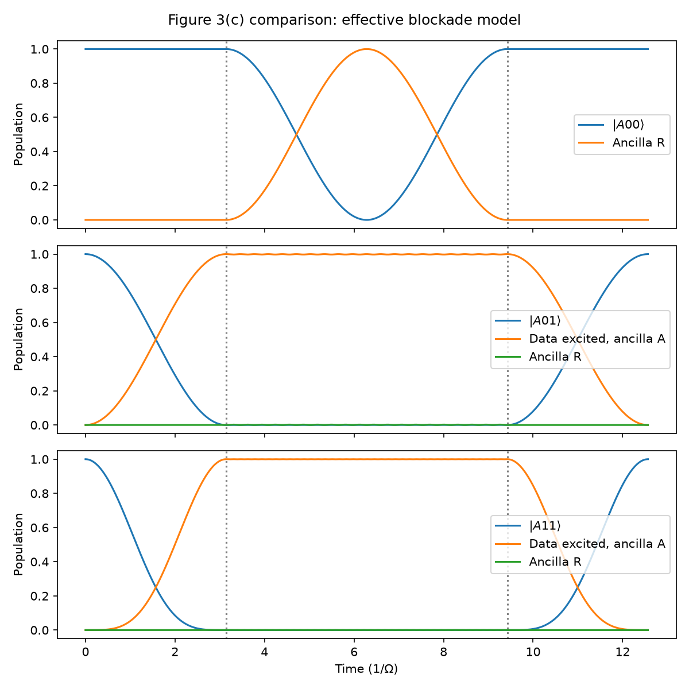
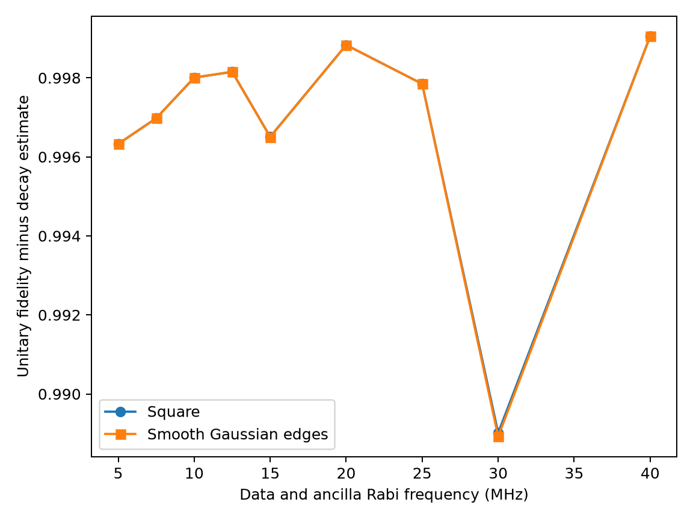

# Numerical notes

The gate proposed by [Zhang, Arunseangroj, and Xu (2025)](https://arxiv.org/abs/2503.16896) uses two data atoms and an ensemble ancilla. The sequence begins with a $\pi$ pulse that excites data atoms from $|1\rangle$ to $|r\rangle$. An ancilla $2\pi$ pulse then drives $|A\rangle\leftrightarrow|R\rangle$, followed by a final data $\pi$ pulse that reverses the first. Rydberg interactions block the ancilla cycle whenever a data atom is excited.

We use the parameters from [Fig. 3(c)](https://arxiv.org/html/2503.16896v1): $\Omega_r=\Omega_R=2\pi\times10$ MHz, $V_{Rr}=2\pi\times200$ MHz, and lifetimes of $100\,\mu\mathrm{s}$ for data $|r\rangle$ and $200\,\mu\mathrm{s}$ for ancilla $|A\rangle$ and $|R\rangle$.

## Population dynamics

The first model represents the interaction as a diagonal shift, $V_{Rr}|Rr\rangle\langle Rr|$, for each data atom. Over the $0.20\,\mu\mathrm{s}$ gate, the peak ancilla $|R\rangle$ populations are 1.000000, 0.002494, and 0.000625 for $|A00\rangle$, $|A01\rangle$, and $|A11\rangle$, respectively. Their final return probabilities are 1.000000, 0.999985, and 0.999999.

These results capture the gate mechanism shown in Fig. 3(c): the ancilla completes its cycle without an excited data atom, while Rydberg interactions suppress that cycle when excitation is present. 

## Gate phases and the Förster model

The ideal gate in [Eq. (4)](https://arxiv.org/html/2503.16896v1) is $\mathrm{diag}(-1,-1,-1,+1)=-CZ$. Our diagonal-blockade model instead gives $\mathrm{diag}(-1,-0.9969-0.0783i,-0.9969-0.0783i,0.9992+0.0392i)$.

Although leakage is only $1.54\times10^{-5}$, the largest phase error reaches 0.078393 rad. This shows why returning nearly all population to the computational states is not enough to guarantee a high-quality gate.

To examine this difference, we also implement resonant $|rR\rangle\leftrightarrow|r'R'\rangle$ coupling based on [Supplementary Eq. (29)](https://arxiv.org/html/2503.16896v1), while leaving out other pair states. The predicted dark state is proportional to $2V_{Rr}|1R\rangle-\Omega_r|r'R'\rangle$. Its calculated energy differs from zero by less than $3.87\times10^{-12}\,\mathrm{rad}/\mu\mathrm{s}$.

For the full gate, this truncated Förster model gives a maximum leakage of 0.000773, no measurable relative phase error, and a noiseless average fidelity of 99.9806%.

## Fidelity comparison

The paper's [Table II](https://arxiv.org/html/2503.16896v1) reports 99.80% gate fidelity. Here, we calculate fidelity as the Haar-average overlap between the data-qubit quantum operation and the target in Eq. (4), tracing out the ancilla while retaining leakage. The noisy simulation evolves 16 basis operators with simplified decay into loss states.

The table compares our results with the reported values. Differences are in percentage points, calculated as our result minus the paper's value.

| Quantity | Paper | Here | Difference |
| --- | ---: | ---: | ---: |
| Average fidelity | 99.8000% | 99.7351% | $-0.0649$ |
| Data decay error | 0.1500% | 0.1498% | $-0.0002$ |
| Ancilla decay error | 0.0300% | 0.0299% | $-0.0001$ |
| Blockade error, diagonal model | 0.0200% | 0.0852% | $+0.0652$ |
| Blockade error, noiseless Förster model | 0.0200% | 0.0194% | $-0.0006$ |

The first four computed entries use the diagonal interaction, while the last uses the truncated Förster interaction without decay. The decay errors are measured separately in the diagonal model and should not be added as independent contributions to the combined channel.

The data-decay population integral also gives 0.1500%, consistent with [Supplementary Eq. (28)](https://arxiv.org/html/2503.16896v1). 

## Pulse shaping and drive strength

[Supplementary Fig. 4(a)](https://arxiv.org/html/2503.16896v1) reports better high-drive performance with smooth pulses. We test a smooth data pulse with Gaussian-like edges, keeping the same duration and area as the square pulse. The ancilla pulse remains square.

At 10 MHz, the noiseless Förster fidelities are 0.9998063 for the square pulse and 0.9998066 for the smooth pulse. The drive sweep from 5 to 40 MHz applies first-order decay estimates to the noiseless results rather than simulating the full noisy dynamics. Under these pulse constraints, smoothing gives no consistent advantage, so the published high-drive improvement is not reproduced here.

